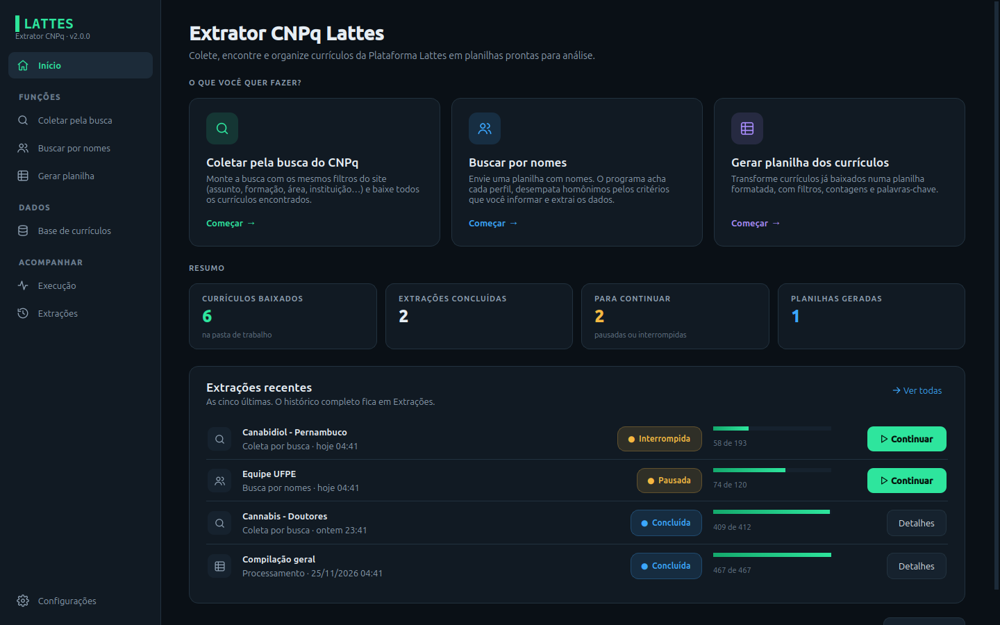

# Extrator CNPq Lattes

Programa com interface gráfica para coletar currículos da Plataforma Lattes (CNPq), encontrar perfis a partir de uma planilha de nomes e gerar planilhas Excel prontas para análise.



## Funções

| Função | O que faz |
|---|---|
| **Coletar pela busca do CNPq** | Réplica da tela de busca do site (assunto/nome, bases, nacionalidade e os 10 filtros: bolsa, formação, área de atuação, idioma, instituição…). Percorre todas as páginas de resultado e baixa cada currículo. |
| **Buscar por nomes** | Lê uma planilha com nomes, busca cada um, desempata homônimos pelos critérios das outras colunas e extrai o perfil encontrado. |
| **Gerar planilha dos currículos** | Processa os HTMLs já baixados (em paralelo) e gera o Excel formatado e um `.txt` (TSV) completo para Power BI. |
| **Base de currículos** | Tudo o que já foi baixado num só lugar: busca de texto completo (sem acento, frase exata entre aspas), filtros por pasta e titulação, ordenação, prévia ao lado e perfil completo com visão geral, seções navegáveis e o currículo original aberto dentro do programa. |
| **Extrações** | Histórico com status e progresso. Uma extração interrompida continua de onde parou. |

Durante a execução aparecem: barra de progresso, velocidade, tempo restante, erros, memória usada e o registro (log) colorido. Dá para pausar ou interromper.

## Instalação e uso

Requer Python 3.10+ e o Google Chrome instalado.

```bash
python -m venv .venv
```

```bash
.venv/bin/pip install -r requirements.txt
```

```bash
.venv/bin/python main.py
```

No Windows, use `.venv\Scripts\pip` e `.venv\Scripts\python`.

### Linha de comando

```bash
python -m lattes_extrator --help
```

Subcomandos: `processar`, `coletar`, `nomes`, `template`, `listar`, `continuar`.

## Busca por nomes

1. Baixe o template na própria tela da função (ou `python -m lattes_extrator template`).
2. Preencha a coluna **Nome**. As demais colunas são opcionais e funcionam como critério de desempate: formação, curso, instituição de formação, ano, UF, área de atuação, instituição onde trabalha, palavras-chave, nome em citações, ID Lattes, ORCID ou qualquer outro atributo do currículo.
3. Para cada nome o programa:
   - busca no CNPq com os filtros escolhidos;
   - fica com os perfis de nome compatível (se existir um nome idêntico, os aproximados saem);
   - desempata comparando cada critério com o trecho certo do resumo da busca;
   - se ainda empatar, abre o currículo completo dos melhores colocados e compara de novo.
4. A planilha final traz o status de cada linha (**Encontrado**, **Desempatado**, **Verificar**, **Ambíguo**, **Não encontrado**), o link do Lattes, a confiança e o motivo. A aba *Candidatos* lista todos os perfis considerados, e a aba *Perfis* traz os dados completos de quem foi encontrado.

## Planilhas de saída

- Cabeçalho formatado, painel congelado, filtro em todas as colunas, linhas listradas, links clicáveis e cores por status.
- Aba **Perfis**: uma linha por pesquisador. Inclui identificação (ID Lattes, código CNPq, ORCID, nome em citações), maior titulação, instituição atual, áreas de atuação, contagens de produção, métricas de citação (Web of Science, Scopus, SciELO), palavras-chave e todas as seções do currículo.
- Abas **Resumo** e **Dicionário** (o que é cada coluna).
- Células acima do limite do Excel (32.767 caracteres) são cortadas com marcação. O `.txt` mantém o texto completo.

## Sobre o acesso ao CNPq

- Tudo é feito num Chrome real e visível, no ritmo configurado (5 s entre currículos por padrão).
- A busca usa o próprio formulário do site.
- Se o CNPq pedir verificação (captcha), o programa avisa com som e espera você resolver na janela do Chrome. Ele não resolve captcha sozinho.

## CI (executáveis automáticos)

Cada push na `main` roda os testes e gera o `ExtratorLattes.exe` (Windows) e o executável Linux no runner próprio. Uma tag `v*` publica uma Release com os dois. Detalhes, inclusive o token do runner, em [docs/ci.md](docs/ci.md).

## Gerar o executável

**Windows:** execute `build.bat`. O programa fica em `dist\ExtratorLattes\ExtratorLattes.exe`.

**Linux/macOS:**

```bash
./build.sh
```

O programa fica em `dist/ExtratorLattes/ExtratorLattes`.

Manualmente, com as dependências de `requirements-dev.txt` instaladas:

```bash
pyinstaller ExtratorLattes.spec --noconfirm --clean
```

Para gerar um arquivo único (abre mais devagar), rode no Windows `set ONEFILE=1` e depois o `pyinstaller`. No Linux:

```bash
ONEFILE=1 pyinstaller ExtratorLattes.spec --noconfirm --clean
```

O executável precisa ser gerado em cada sistema (o `.exe` sai do Windows). O Chrome precisa estar instalado na máquina que vai rodar o programa.

## Estrutura

```
main.py                      entrada (interface; --cli para linha de comando)
lattes_extrator/
  parser.py                  HTML do Lattes -> registro (lxml, passada única por seção)
  processamento.py           processamento paralelo + planilhas em streaming
  exportar.py                Excel estilizado (xlsxwriter) e TSV
  navegador.py               Chrome/Selenium no buscatextual.cnpq.br
  filtros.py                 filtros da busca (espelho do formulário do CNPq)
  coleta.py                  coleta pela busca, retomável
  busca_nomes.py             busca por planilha de nomes
  desempate.py               critérios e pontuação dos homônimos
  planilhas.py               template e leitura da planilha de nomes
  jobs.py                    histórico/retomada (SQLite)
  base.py                    índice pesquisável dos currículos (SQLite FTS5, incremental)
  config.py, eventos.py, texto.py
  gui/                       interface PySide6 (intro, janela, páginas, réplica do CNPq)
  data/                      catálogo de filtros do CNPq, arte ASCII, ícone
tools/
  atualizar_catalogo.py      baixa de novo as opções de filtro do site
  capturas.py                gera as capturas de tela de docs/prints
tests/                       pytest (python -m pytest -q)
```

Se o CNPq mudar as opções de filtro, rode `python tools/atualizar_catalogo.py`.

O visualizador do currículo original usa as folhas de estilo e imagens do próprio CNPq, guardadas em `lattes_extrator/data/lattes_web/` para funcionar sem internet. Para baixá-las de novo:

```bash
python tools/baixar_estilo_lattes.py
```

Ele mostra a página igual ao site quando o pacote `PySide6_WebEngine` está instalado (já incluído em `requirements.txt`). Sem esse pacote, o programa usa um modo simplificado que remonta o layout em tabelas.
